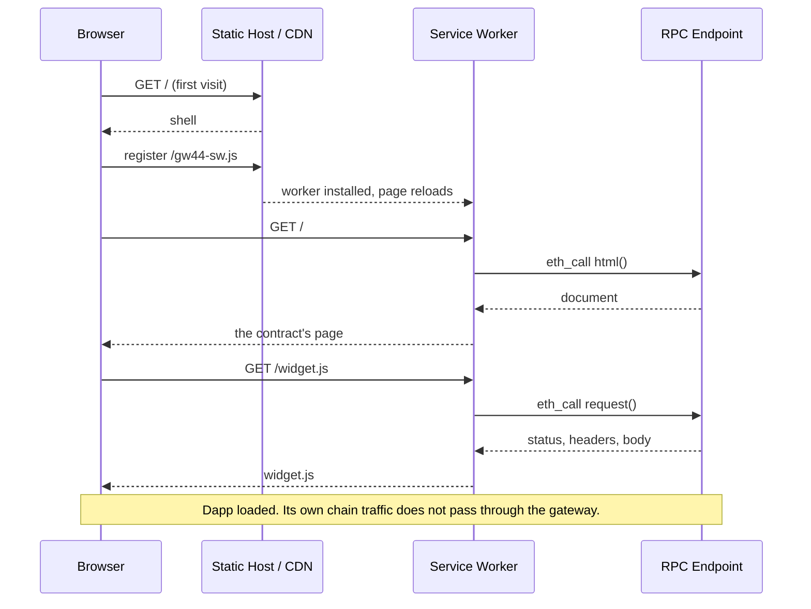

# DNZN // GW44

A web gateway built specifically for contract-hosted, on-chain dapps: front ends a contract serves itself through [ERC-8244](https://eip.tools/eip/8244) `html()` and [ERC-5219](https://eips.ethereum.org/EIPS/eip-5219) `request()`.

by **Denizen.** // dxnzn.wei

## How it Works

The gateway is two static files. A page shell installs a service worker, and from then on the worker answers every `GET` for a URL on the contract's origin by calling the contract from the visitor's browser, straight to a public RPC endpoint: `html()` for the page, `request()` for each file the page loads from that origin. Where service workers are unavailable, the shell makes the `html()` call itself.

That is the only time the gateway's RPC endpoint is used: to load the dapp. Once the dapp is running, its chain traffic is its own. Calls through a connected wallet go to the wallet's endpoint, calls the dapp makes directly go wherever it sends them, and the worker passes both through untouched.

There is no gateway server, so there is nothing between the chain and the reader that can hold a stale copy: nothing is cached, and a document the owner changes is what the next reload shows. Each contract gets its own origin, `<contract>.<chain>.<base>`, so one contract's document cannot touch another's.



## Motivation

Gateways are where decentralization breaks down for on-chain dapps. The whole point of ERC-8244 is that the code lives on-chain, with no backend. But a browser cannot read a chain, so the page arrives through a gateway, and a hosted gateway is a backend again: a server between the user and the contract that has to be trusted.

gw44 complements ERC-8244 and ERC-5219 by stripping the gateway down to two static files, about 16 KB in total, that can be self-hosted or distributed globally through a CDN.

No backends. Minimal trust boundaries between the user and the on-chain dapp.

## Release Info

### Project Status

| STATUS | VERSION | AUDIT |
|:---|:---|:---|
| `pre-mvp` | `0.0.0` | no review, no external audit; see [SECURITY.md](SECURITY.md) |

A working prototype from a spike. It is not deployed anywhere; `gw44` is a working name. What the spike measured and what it could not do are in [docs/spikes/001-static-gateway.md](docs/spikes/001-static-gateway.md).

Alpha software is alpha, act accordingly. See [Disclaimer](#disclaimer).

### Disclaimer

Alpha software. Nothing here has been reviewed by anyone but its authors, and there is no external audit ([SECURITY.md](SECURITY.md)). No warranty. gw44 shows what a contract and an RPC endpoint return and vets neither: the document is the contract owner's, not ours, and one endpoint's answer is taken as the chain's. A dapp loading through gw44 says nothing about whether it is safe to connect a wallet to.

### URLs

| FORM | URL | WHERE |
|:---|:---|:---|
| host | `https://<contract>.<chain>.<base>/<path>` | anywhere; the public form |
| path | `http://localhost:8244/<chain>/<contract>/<path>` | loopback only |

`<chain>` is the decimal chain id and `<contract>` the 0x address. The path form puts every contract on one origin, so the gateway refuses it on any host that is not loopback. The host form also works locally: `http://<contract>.<chain>.localhost:8244/`.

### What it does not do

- **Answer another site's `<script src>`.** A service worker serves its own pages only. A third-party page that embeds `https://<contract>.<chain>.<base>/widget.js` gets the page shell, not the script. This is the limit of having no server, and [the roadmap](docs/ROADMAP.md) carries the decision it forces.
- **Answer `curl`, crawlers or link previews.** They get the shell too. `make get URL=<url>` resolves a gateway URL through the same code without a browser.
- **Verify the RPC endpoint.** One endpoint's answer is taken as the chain's.
- Names and custom domains yet; they are the roadmap's last milestone.
- IPFS, the other `web3://` resolve modes, compressed `request()` bodies.

## Documentation

| DOCUMENT | DESCRIPTION |
|----------|-------------|
| [Roadmap](docs/ROADMAP.md) | Milestones, decisions and status |
| [Spike 001](docs/spikes/001-static-gateway.md) | Whether a gateway with no backend works, measured |
| [Security](SECURITY.md) | Trust model, what the gateway defends and what it does not |
| [Working Conventions](AGENTS.md) | Layout, commands and gotchas for contributors, human or agent |

## Development

### Common Helpers

```bash
make init           # Initialize the development environment (devbox, git hooks)
make serve          # Build, then serve on http://localhost:8244/<chain>/<contract>/
make check          # Typecheck, unit tests, browser tests
make verify         # Prove the gateway serves what a live chain returns (network)
make browsers       # Install Playwright's browsers for ENGINES
make get URL=<url>  # Resolve one gateway URL without a browser
make build PIN=…    # Build for one contract only (see The pinned build)
make help           # List every command
```

Node 24 and `process-compose` come from `devbox`; run the targets through `devbox shell` or `devbox run -- make <target>`.

**Browser engines.** `make e2e` runs the browser suite once per engine in `ENGINES`, in order, stopping at the first failure; the default is `ENGINES=chromium`. The names are `chromium`, `firefox` and `webkit`, and any other name fails rather than being skipped. `make browsers` downloads them into Playwright's cache — Chromium arrives as `chromium-headless-shell`.

**Only Chromium is expected to run on a plain checkout.** Firefox and WebKit need system libraries that are not part of `devbox`, so on a machine without them `make e2e ENGINES=firefox` fails at launch with Playwright's "Host system is missing dependencies" and a list. That is a failure and not a skip, deliberately. The three engines all run in CI, which installs the libraries with `playwright-core install --with-deps`.

To run them locally, `sudo npx playwright-core install-deps firefox webkit` once. That install is enough **because** `make e2e` sets `PLAYWRIGHT_SKIP_VALIDATE_HOST_REQUIREMENTS=1` (`mk/10-gateway.mk`): Playwright's pre-launch check shells out to `ldd`, and under `devbox run --` that is nix's `ldd`, which cannot see system libraries however they were installed. Without the skip the install would make no difference and the engines would still refuse to start.

### The pinned build

```bash
make build PIN=11155111:0x00a9f390a6010d045e0d34856048ddd6910d25ba
```

The same three files, built to serve **one** contract at **every** URL on the origin you host them on — so `https://your-domain.example/` is that contract's document and `https://your-domain.example/widget.js` is its `widget.js`. The pin is compiled in, exactly as the endpoints are: there is no URL on a pinned build that reaches a second contract, and the hostname is never read, so neither the `<address>.<chain>.<host>` form nor the `/<chain>/<address>/` form means anything there. A path that looks like the second form is just a path, and is asked of the pinned contract as a resource of that name.

Only the pinned chain's endpoints are compiled in. Point `GW44_CHAINS` at a file of your own to use your own endpoints rather than the public ones in [`chains.json`](chains.json):

```bash
GW44_CHAINS=my-chains.json make build PIN=11155111:0x00a9f390a6010d045e0d34856048ddd6910d25ba
```

An owner can put the result on a domain of their own, with no dependence on a public gateway existing. Hosting instructions are not here yet: `docs/DEPLOY.md` arrives with m01-t05.

**`make verify` is the one target that reaches a live chain**, and it is not part of `make check` and not in CI. It reads the fixture contract on Sepolia and Base Sepolia through the endpoints in [`chains.json`](chains.json), decodes the ABI with `cast` and shell arithmetic rather than with anything under `src/`, and compares both hashes with what `tools/get.ts` serves; it finishes by loading the document in headless Chromium. So it needs the network and those two chains reachable. `VERIFY_CHAINS` and `VERIFY_ADDRESS` override what it checks, and `VERIFY_STATUS` the status an ERC-5219 resource must answer. It checks the pinned build too: per chain, the same bytes resolved through a pin from a URL that names no contract, and the pinned document loaded in a browser on its own port.

The RPC endpoints are [`chains.json`](chains.json), compiled into the worker at build time. To serve another chain, add it there and rebuild; `GW44_CHAINS=<file> make build` uses a different file. Chain `31337` points at `http://127.0.0.1:8545`.

Deploying is copying `dist/` to a static host that answers unknown paths with `index.html` (`404.html` is the same file, for hosts that use that name).

## Development Team

| Name | GPG Key | GitHub | EOA |
|:-----|:--------|:-------|:----|
| Denizen. | [`0DC6C60CFBD5E456`](https://keys.openpgp.org/search?q=CD435BB6A7BED718D95616450DC6C60CFBD5E456) | [`dxnzn`](https://github.com/dxnzn) | [`0x3578...902B`](https://etherscan.io/address/0x357836fFcB45307FA7ff2A574F505753c961902B) *dxnzn.wei* |
| Elanik. | [`70B6B0BB5F26178A`](https://keys.openpgp.org/search?q=DC49D48844590FA752780FFE70B6B0BB5F26178A) | [`elanikk`](https://github.com/elanikk) | [`0x5A15...C50d`](https://etherscan.io/address/0x5A158aF8DC28FE756dB81Ef669e4Db2536bBC50d) *elanik.wei* |
| Lakos. | [`591DE0ECA387697A`](https://keys.openpgp.org/search?q=B7EABCBD80422BCC1AE0B23F591DE0ECA387697A) | [`lakkoss`](https://github.com/lakkoss) | [`0x9a54...4529`](https://etherscan.io/address/0x9a5489bB67d68ABABdA050A3b52d4F98Fe224529) *lakos.wei* |

## License

MIT — see [LICENSE](LICENSE).
